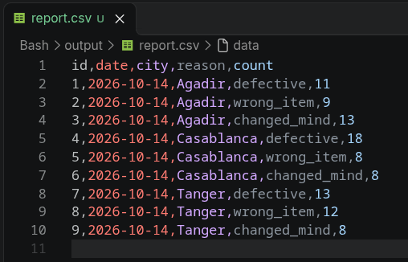
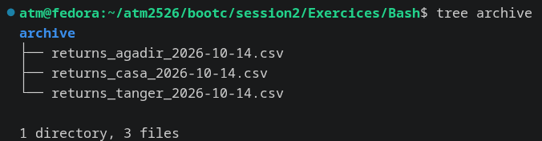

# Module 2 — Exercice Bash : Traitement ETL des retours clients

Ce projet met en place un pipeline automatisé de traitement des données de retours clients (`returns.csv`) pour 3 succursales BIM (Agadir, Casablanca, Tanger).

Ce script réalise un **comptage par catégorie de retour** (`defective`, `wrong_item`, `changed_mind`).

---

## Partie A : Préparation du terrain

- **Création de l'arborescence du workspace :**

```bash
mkdir -p input output archive errors trash logs
```

```text
Bash/
├── input/      # Fichiers CSV bruts reçus quotidiennement
├── output/     # Rapports finaux générés (comptage par catégorie)
├── archive/    # Fichiers source traités et horodatés
├── errors/     # Fichiers non conformes (colonnes manquantes)
├── trash/      # Fichiers temporaires ou corrompus
└── logs/       # Journaux d'exécution du script
```

- **Déplacement des fichiers CSV bruts dans le dossier d'entrée :**

```bash
mv ../returns_*.csv input/
```

- **Inspection de l'en-tête de returns_agadir.csv:**

```bash
head -n 1 input/returns_agadir.csv
```

return_id,product_name,reason,city

## Partie B : Validation et correction automatique des fichiers

- **Détection de l'anomalie:**

L'inspection initiale des premières lignes avec `head -n 1 input/*.csv` a révélé que la succursale de **Tanger** utilise la colonne `category` à la place de `reason` :

| Fichier            | Colonnes                                |
| :----------------- | :-------------------------------------- |
| returns_agadir.csv | return_id, product_name, reason, city   |
| returns_casa.csv   | return_id, product_name, reason, city   |
| returns_tanger.csv | return_id, product_name, category, city |

Pour détecter cette anomalie de manière automatisée dans un script, nous utilisons le test d'en-tête suivant :

- **Test de détection automatique :**

```bash
head -n 1 input/returns_tanger.csv | grep "reason"
```

le code sur le terminal ne va rien afficher, ce qui signifie que 'reason' n'existe pas dans l'en-tête du fichier returns_tanger.csv.

- **Correction du fichier :**

```bash
sed -i 's/category/reason/' input/returns_tanger.csv

```

Cette commande cherche le mot category dans le fichier de Tanger et le remplace instantanément par reason

### PARTIE C : Comptage des retours par catégorie (exemple pour Agadir)

```bash
grep -c "defective" input/returns_agadir.csv
grep -c "wrong_item" input/returns_agadir.csv
grep -c "changed_mind" input/returns_agadir.csv
```

Résultat :  
defective : 11  
wrong_item : 9  
changed_mind : 13

- **Génération du rapport.csv**

J'ai regroupé les résultats des trois succursales dans un seul fichier `output/report.csv`, avec les colonnes `id,date,city,reason,count`.

Les comptes sont calculés avec `grep -c`, puis ajoutés au rapport avec `echo` et `>>`. Chaque ligne possède un identifiant unique de 1 à 9.

Le rapport contient 9 lignes de données, soit 3 catégories pour chacune des 3 succursales.

**Résultat obtenu :**



- **Archivage des fichiers traités**

Pour archiver les fichiers CSV avec la date du jour dans leur nom, j’utilise une boucle `for` et la commande `cp` afin de conserver les fichiers originaux dans le dossier `input/`.

```bash
for file in input/returns_*.csv; do
    base=$(basename "$file" .csv)
    cp "$file" "archive/${base}_$(date +%F).csv"
done
```

- `for` : parcourt les fichiers CSV correspondant au motif indiqué.
- `basename` : récupère le nom du fichier sans l’extension `.csv`.
- `date +%F` : récupère la date du jour au format `AAAA-MM-JJ`.
- `cp` : copie chaque fichier dans le dossier `archive/` en ajoutant la date à son nom.

**Résultat obtenu :**



## Partie D : Regroupement du tout dans un Script

Voir le script `returns_processor.sh`, le résultat dans `output/report_2026-10-19.csv` et le log du jour dans `logs/run_2026-10-19.log`.

### BONUS

Avec `grep -c ",$reason,"`, on ne compte que les lignes où la valeur est exactement dans sa propre colonne, entourée de virgules. Avec `grep -c "$reason"` tout court, on compterait aussi toute ligne où le mot apparaît ailleurs, par exemple dans un autre champ ou comme morceau d'un mot plus long (`not_defective`, un commentaire qui contient "defective"...), ce qui fausserait le compte.
