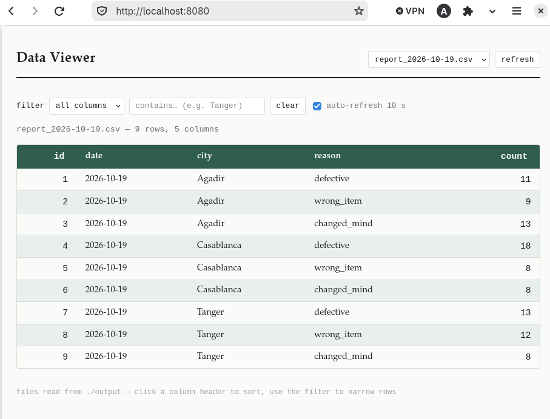

# Module 2 - Exercice Docker : Containerisation de `returns_processor.sh`

Ce projet consiste à containeriser un script Bash de traitement des retours clients d'une enseigne BIM. Le script traite les fichiers CSV, calcule le nombre de retours par catégorie et par succursale, génère un rapport et archive les fichiers traités.

Docker permet d'isoler l'exécution du script, et Docker Compose sert à orchestrer le traitement et la consultation du rapport avec Nginx.

## Partie A : Construction de l'image Docker

### 1. Dockerfile

Le fichier Dockerfile utilise Alpine Linux et les outils nécessaires à l'exécution du script :

- Image de base : alpine:3.20
- Paquets : bash, gawk et coreutils
- Répertoire de travail : /app
- Copie de returns_processor.sh et ajout du droit d'exécution

### 2. Construction de l'image

Après le démarrage du service Docker :

```bash
sudo systemctl start docker
```

J'ai construit l'image avec la commande :

```bash
docker build -t bim-returns:1.0 .
```

Le nom de l'image est `bim-returns` et son tag est `1.0`. Le point indique que le dossier courant est utilisé comme contexte de construction.

## Partie B : Lancement et observation du conteneur

### 1. Choix du mode d'exécution

Le conteneur reste actif et relance le script toutes les 10 secondes grâce à la boucle définie dans le `CMD` du Dockerfile.

**Justification :** les fichiers de retours arrivent au fil de la journée, donc le conteneur doit surveiller `input/` toutes les 10 secondes au lieu de tourner une seule fois et de rater les fichiers qui arrivent après.

Quand `input/` est vide, le script ne fait rien (le test `[ -e "$f" ] || continue` saute la boucle), donc rester en vie ne coûte presque rien.

### 2. Lancement du conteneur

J'ai vérifié la présence des trois fichiers CSV, puis ajouté le droit d'exécution au script :

```bash
ls input/
chmod +x returns_processor.sh
```

Le `chmod` sur ma machine est nécessaire, car le bind mount remplace `/app` par mon dossier local : c'est donc le script de mon disque qui est exécuté, avec ses propres permissions.

J'ai ensuite lancé le conteneur avec un _bind mount_ du workspace :

```bash
docker run -d --name returns -v "$(pwd)":/app:Z bim-returns:1.0
```

_Le bind mount permet au conteneur d'accéder aux fichiers de mon projet sans devoir les copier dans le conteneur._  
Mon script peut ainsi lire les CSV du dossier `input/`, écrire le rapport dans `output/` et archiver les fichiers dans `archive/`, et ces changements sont visibles directement sur ma machine. (Le `:Z` est nécessaire sur Fedora à cause de SELinux, sinon le conteneur n'a pas le droit de lire le dossier monté.)

### 3. Vérification et résultats

```bash
docker ps
docker logs -f returns
```

`docker ps` a confirmé que le conteneur `returns` était en état `Up`, ce qui est le comportement attendu avec la boucle : il ne s'arrête pas. `docker logs -f` a affiché les trois jobs au démarrage, puis est resté silencieux tant que `input/` était vide. En copiant un CSV dans `input/` pendant que les logs défilaient, le job est apparu en moins de 10 secondes, ce qui confirme que le conteneur surveille bien le dossier.

Les logs confirment le traitement des trois succursales et l'archivage des fichiers CSV.

| Succursale | `defective` | `wrong_item` | `changed_mind` |
| ---------- | ----------: | -----------: | -------------: |
| Agadir     |          11 |            9 |             13 |
| Casablanca |          18 |            8 |              8 |
| Tanger     |          13 |           12 |              8 |

Les trois fichiers ont été archivés avec la date du traitement : `2026-10-19`.

Avant de passer à la partie C, j'ai arrêté et supprimé ce conteneur :

```bash
docker stop returns && docker rm returns
```

## Partie C : Orchestration avec Docker Compose

### 1. Fichier `docker-compose.yml`

```yaml
services:
  processor:
    build: .
    volumes:
      - .:/app:z

  viewer:
    image: nginx:alpine
    volumes:
      - ./viewer:/usr/share/nginx/viewer:ro,z
      - ./output:/usr/share/nginx/output:ro,z
      - ./viewer.conf:/etc/nginx/conf.d/default.conf:ro,z
    ports:
      - "8080:80"
```

Le fichier définit deux services :

- `processor` : construit l'image à partir du Dockerfile du dossier (`build: .`) et monte tout le workspace dans `/app`, comme dans la partie B.
- `viewer` : utilise `nginx:alpine` pour servir le dossier `output/` en lecture seule, avec la page `viewer/index.html` et la configuration `viewer.conf`. Le port 8080 de ma machine est relié au port 80 du conteneur.

### 2. Démarrage et vérification

```bash
docker compose up -d
docker compose ps
```

Les deux services sont `Up`, et le rapport s'affiche sur `http://localhost:8080/`.



La page affiche les 9 lignes du rapport (3 succursales x 3 catégories), avec les mêmes valeurs que dans le tableau de la partie B. Elle se rafraîchit toute seule toutes les 10 secondes, donc un CSV déposé dans `input/` est traité par le `processor` puis apparaît dans le tableau.

### 3. Arrêt des services

```bash
docker compose down
```

Cette commande arrête et supprime les conteneurs et le réseau créés par Compose. Mes fichiers locaux restent en place.

## Conclusion

Cette mise en pratique m'a permis de construire une image Docker pour un script Bash, de lancer un conteneur avec un workspace partagé et de vérifier le traitement à travers les logs. Avec Docker Compose, j'ai ensuite orchestré le traitement et l'affichage du rapport avec Nginx : un seul `docker compose up -d` démarre les deux services, et le rapport est consultable dans le navigateur.
